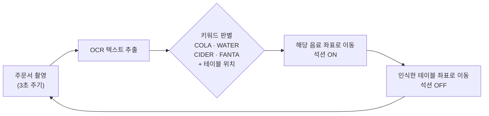

# 🍹 무텐더 — OCR · 비전 AI 기반 Dobot 스마트 바텐더

> 카메라로 **주문서를 읽어(OCR)** 어떤 음료를 어느 테이블로 보낼지 판단하고,
> 로봇팔(Dobot Magician Lite)이 해당 음료 블록을 집어 테이블로 옮기는 자동화 프로젝트입니다.

<!-- 📌 시연 영상(GIF)을 여기에 넣으세요 — 이 프로젝트는 영상이 가장 좋은 설명입니다

-->

| 항목 | 내용 |
|---|---|
| 기간 | 2026.03 – 2026.06 |
| 인원 | 2인 (황승구 · 조원준) |
| 내 역할 | **팀장** |
| 기술 | Dobot Magician Lite · DobotLab(블록 코딩) · 내장 OCR / 비전 AI 블록 · 석션·그리퍼 엔드 이펙터 · 웹캠 |

<br>

## 1. 목표와 결과



| 목표 | 결과 | 달성도 |
|---|---|---|
| OCR로 주문 음료·테이블 위치 인식 | 음료명·테이블 위치 텍스트 인식 성공 | 100% |
| 음료 위치로 이동해 픽업 | 지정 좌표 기반 픽업은 성공, 비전 기반 동적 픽업은 불안정 | 50% |
| 테이블로 옮겨 내려놓기 | 인식한 테이블 위치에 정확히 배치 | 100% |

## 2. 단계별 개발 과정

한 번에 최종 시스템을 만들지 않고, 로봇 제어 → 반복 동작 → 비전 연동 순서로 단계를 밟았습니다.

| 단계 | 파일 | 내용 |
|---|---|---|
| 01 티칭 | [`programs/01_teaching_playback/`](programs/01_teaching_playback) | 손으로 위치를 가르쳐 녹화(Teaching & Playback)한 블록 이송 동작. Jump 이동 + 석션 ON/OFF 조합으로 블록 5개 옮기기 |
| 02 반복 동작의 함수화 | [`programs/02_gripper_stacking/gripper_stacking.sb3`](programs/02_gripper_stacking) | 그리퍼로 블록을 집어 쌓는 동작. 좌표를 변수로 두고 **사용자 정의 블록(함수) 10개**로 "집기 / 옮기기 / 놓기"를 분리해 반복 호출 |
| 03 비전 연동 | [`programs/03_vision_color_pick/vision_color_pick.sb3`](programs/03_vision_color_pick) | 카메라로 블록을 **색상별 인식** → 픽셀 좌표를 로봇 좌표로 변환 → 석션 픽업 → 지정 위치에 한 층(10.5mm)씩 쌓기 |
| 04 최종 | `programs/04_ocr_bartender/` *(추가 예정)* | OCR 주문 인식 + 음료·테이블 좌표 제어를 결합한 무인 바텐더 |

<!-- ✏️ 최종 OCR 바텐더 프로그램(.sb3)을 programs/04_ocr_bartender/ 에 넣고 위 표의 링크를 연결하세요. -->

### 03 비전 연동의 핵심 — 카메라 좌표 → 로봇 좌표 보정

카메라가 찾은 물체 위치는 **픽셀 좌표**라서 그대로는 로봇이 이동할 수 없습니다.
DobotLab의 보정 기능으로 두 좌표계를 잇는 **2×3 아핀 변환 행렬**을 구해 저장했습니다
([`calibration/`](programs/03_vision_color_pick/calibration)).

```json
{"matrix": [[-0.00705, -0.40195, 397.18],
            [-0.39931,  0.00320, 114.58]]}
```

```
[로봇 X]   [a  b  c]   [픽셀 u]
[로봇 Y] = [d  e  f] · [픽셀 v]
                        [  1  ]
```

카메라나 작업대 위치가 바뀌면 행렬도 달라지기 때문에 날짜별로 다시 보정했습니다.
행렬로 변환한 뒤에도 남는 오차는 X·Y 보정 변수(`X보정 = -14`, `Y보정 = 18`)와 집기 높이 변수(`Dz`)로 조정했습니다.

## 3. 한계와 우회 전략

**처음 계획**: 외부 Python 환경에서 Tesseract OCR + 색상 인식 비전 AI를 결합해 로봇을 제어
**바뀐 이유**
- 두봇 티칭 환경은 외부 API·Python 연동과 확장성이 제한적이었고, 일정도 부족했습니다.
- 블록 코딩의 비전 기능만으로는 "인식한 여러 물체 중 **주문한 음료만** 골라 집는" 동작을 구현할 수 없었고, 카메라 인식을 따라 이동하는 방식은 성공률이 불안정했습니다.

**해결**: OCR은 DobotLab 내장 블록으로 처리하고, 음료 픽업 위치는 **정밀 좌표 + 변수 연산**으로 고정해
"주문 인식 → 픽업 → 테이블 배치" 자동화 흐름을 끝까지 완성했습니다.

## 4. 실행 방법

1. [DobotLab](https://www.dobot-robots.com/)을 설치하고 Dobot Magician Lite를 USB로 연결합니다.
2. `.sb3` 파일은 DobotLab **블록 프로그래밍**에서, `.playback` 파일은 **Teaching & Playback**에서 엽니다.
3. 비전 프로그램(03)은 실행 전 작업대에서 카메라 보정을 다시 하거나, `calibration/`의 행렬을 불러옵니다.

## 5. 회고

- 블록 코딩 환경의 확장성 한계 때문에 "카메라로 모든 것을 해결"하지 못한 점이 아쉽습니다.
  다음에는 처음부터 Python SDK(`pydobot` 등)로 제어해 OCR·비전 처리를 자유롭게 붙이고 싶습니다.
- 그래도 좌표 보정, 반복 동작의 함수화, 인식 결과에 따른 분기 제어를 직접 다루며 **자동화 로봇이 실제로 어떻게 동작하는지** 이해할 수 있었습니다.
